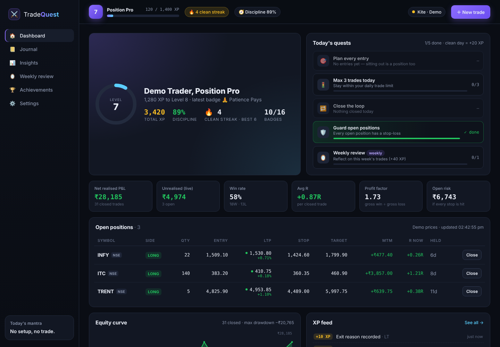

# ⚔️ TradeQuest

A gamified stock-trading journal for Indian markets, with light and night modes. You can type prices in yourself, or pull **live prices from Zerodha Kite Connect**.

The game rewards **process, not profit**. You earn XP for setting a stop before entry, keeping risk inside your limit, following your plan, honouring stops and writing lessons. You lose XP for revenge trades, oversized positions, widened stops and broken plans. A disciplined loss earns more than a lucky, oversized win.



## Quick start

Requires **Node.js 18+**. There are no npm dependencies.

```bash
git clone https://github.com/vikslap/tradeq.git
cd tradeq

npm run demo     # try it: sample journal + simulated prices → http://127.0.0.1:5173
npm start        # your real journal (data/journal.json)
```

Demo mode keeps its data in `demo-data/` and never touches your real journal.

## Connecting Zerodha Kite (live prices)

1. Create an app at [developers.kite.trade](https://developers.kite.trade). Live quotes need the paid **Kite Connect** plan.
2. Set the app's **Redirect URL** to `http://127.0.0.1:5173/api/kite/callback`.
3. Copy `.env.example` to `.env` and fill in `KITE_API_KEY` and `KITE_API_SECRET`.
4. Run `npm start`, open **Settings → Connect to Kite** and log in.

Kite sessions expire around 6 AM every day, so connect once each morning. Your API secret stays on the server and is never sent to the browser. The server listens on `127.0.0.1` only.

**With Kite connected you get:**
- **⚡ Live** buttons that fill entry and exit prices with the current LTP. Entries made this way are tagged, and the *Live Wire* badge counts them.
- Symbol search across NSE, BSE, NFO and MCX, with lot sizes. The instrument list is cached daily.
- Live MTM, R-multiple and day change for open positions, refreshed every 5 seconds.
- **Today's Kite fills**: turn an executed order into a journal entry, or use it as the exit of a matching open trade.
- **Trade charts**: open any trade to see it on a candlestick chart, with entry, stop, target and exit marked, and the risk and reward zones shaded for the time you were in the trade. The candle size depends on how long you held: 5-minute up to 2 days, hourly up to about 25 days, daily beyond that. Charts of closed trades are saved on your PC, so they load instantly and work offline.
- **Best / worst price from candles**: the chart also records the best and worst price each trade reached, even if the app wasn't open. That lets the *winner turned into a loss* check catch trades that went +1R and then closed red.
- **Sync with Kite**: compares your open journal trades with your Kite holdings and positions. It flags positions **not in the journal** (one-click *Log trade*), positions **closed at Kite** but still open in the journal (one-click *Close*, with the exit price filled in), and **quantity differences**. The dashboard shows *✓ Matches Kite* or *⚠ N out of sync*, and adds a *Books match Kite* quest.

Without Kite, everything works in manual mode.

## Features

- **Pre-trade check.** Shows position value, risk in ₹ and as a % of capital, and reward:risk. One click sizes the position to your ₹ risk limit, rounded to lot size. It also previews the XP the entry will earn *before* you log it.
- **Close-trade review.** Records exit reason, whether you followed the plan, emotion, lesson and an execution grade. It previews P&L, R and exit XP.
- **Stop tracking.** Trailing a stop is free. Widening one is recorded and penalised. A "typo fix" checkbox lets you correct the original stop without a penalty.
- **Dashboard.** Level, XP, discipline score, clean-trade streak, daily quests, KPIs, open positions, equity curve and XP feed.
- **Insights.** Clean vs rule-breaking trades, the P&L cost of each mistake, R distribution, and P&L by setup, emotion, weekday, exit reason, segment and side. Also a daily P&L heatmap.
- **Weekly review.** The week's stats, a reflection form and a history of past reviews (+40 XP each).
- **Achievements.** A level path, 16 badges with progress bars, the full XP rulebook and an XP log.
- **Data.** Everything lives in one JSON file. It is written atomically, backed up on every start, and can be exported or imported from Settings.


## Trade types and long-term investments

Every entry has a **type**: Intraday, Swing, Positional or Long-term. Trades logged before types existed were tagged automatically: same-day trades as Intraday, up to 20 days as Swing, longer as Positional. You can change any of them.

- **Trading stats stay pure.** The dashboard KPIs, win rate, R, discipline score, clean streak, daily limits and open-risk checks only count Intraday, Swing and Positional trades.
- **The equity curve and Insights have a filter**: *Trading / Long-term / All*. Insights also shows **P&L by trade type**, so you can see which style actually works for you.
- **Long-term holdings follow investing rules.** There's no stop, target or R. Instead they're judged on an investment thesis and a **sell condition** ("what would make me sell?"). You do a **thesis review every 90 days** (+20 XP, rewarded at most every 60 days), and you lose XP if a review is 30+ days overdue or if you sell without a reason or against your own sell condition. The concentration limit still applies.
- **Holdings panel** on the dashboard: invested amount, value, P&L, return, **CAGR per holding** and **portfolio XIRR**, with when each review is due.
- **Kite sync** matches holdings across types: for example 140 ITC as a swing trade plus 60 as a long-term holding = 200 at Kite. You can **Ignore** old holdings you don't want to journal; manage them in Settings.

## How XP works

### Earn
| Rule | XP |
|---|---|
| Trade logged | +10 |
| Stop-loss set before entry | +15 |
| Risk within your ₹ limit | +10 |
| Thesis (20+ chars) · target · setup tag · planned ≥ 2R | +10 · +5 · +5 · +5 |
| Entered at your planned trigger | +5 |
| Exit reason · lesson written | +10 · +10 |
| Followed the plan | +15 |
| Loss kept within 1R | +15 |
| 2R+ / 3R+ winner (let it run) | +15 / +25 |
| Clean trading day | +20 |
| Weekly review | +40 |

### Lose: the mistakes it catches
| Mistake | How it's detected | XP |
|---|---|---|
| No stop-loss at entry | no stop when logged | −10 |
| Oversized risk | risk to stop > your ₹ limit | −20 |
| Impulse trade | no setup and no thesis | −10 |
| Chased the entry | entry beyond your planned trigger by more than the tolerance | −10 |
| Too much capital in one stock | cash-equity position > X% of capital | −10 |
| Too much total open risk | all open trades' risk to stop > X% of capital | −10 |
| Averaged down | added to an open position that was losing | −15 |
| Revenge entry | new entry within N minutes of a losing exit | −15 |
| Over daily trade limit | more than N entries in a day | −10 |
| Traded past daily loss limit | entry after the day's realised loss hit your limit | −15 |
| Sized up after losses (tilt) | after 2 straight losses, risk > 1.3× your usual size | −15 |
| Broke the plan | you answer "No" when closing | −10 |
| Widened the stop | stop moved further away (trailing is free) | −15 each, max 3 |
| Loss ran past the stop | loss worse than −1.5R | −20 |
| Winner turned into a loss | was +1R or better (tracked from live prices, or entered manually), closed red | −15 |
| Cut a winner short | discretionary exit under 1R with a target set | −10 |
| Closed without review | no exit reason and no plan answer | −5 |
| Self-reported mistakes | chased, ignored news, boredom, moved target… (you tick them) | −5 each |

**Mistakes compound.** Two or more mistakes on one trade add a **stack penalty** of −10 for each extra mistake (max −40). Repeating any mistake from your last 5 trades costs another **−5**. Self-reported mistakes cost less than detected ones, so being honest is always cheaper. The *Honest Mirror* badge rewards it.

XP is recalculated from the journal on every load. Editing or deleting a trade can't leave XP out of sync, and it can't be used to farm XP. You set every limit (risk, daily loss, open risk, position size, chase tolerance, trade count, revenge window) in **Settings**.

**Discipline score** is the share of rule checks passed over your last 20 closed trades. **Clean streak** counts consecutive closed trades where every rule was kept and the plan was followed.


## Project layout

```
server.js          HTTP server + JSON API (no dependencies)
lib/store.js       journal storage, validation, stop-move tracking
lib/kite.js        Kite Connect: login, quotes, instrument search, fills; demo mock
public/            the app (vanilla JS modules, no build step)
  game.js          gamification engine (XP rules, levels, badges, quests)
  stats.js         performance statistics
  app.js           UI
scripts/demo.js    seeded demo with simulated prices
test/              node:test unit tests → npm test
```

## Ideas for later

- Partial exits / scaling in
- Zerodha charges calculator
- Chart screenshots stored locally
- Corporate announcements panel (Khabri Laal feed)
