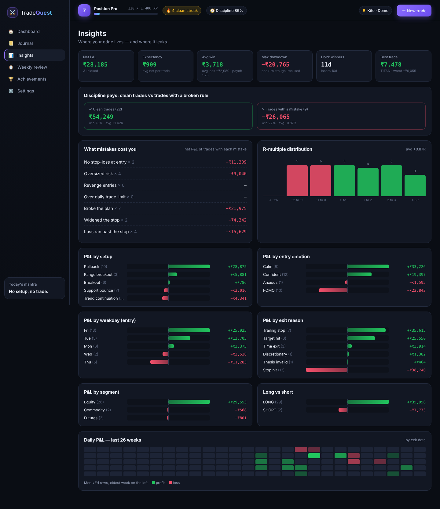
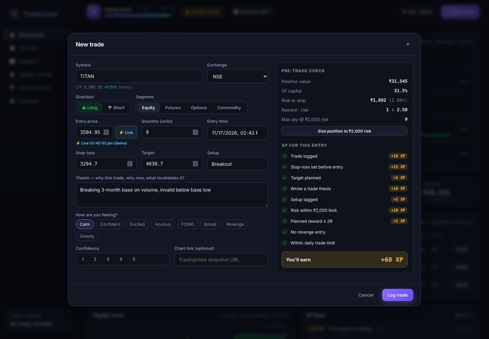

# ⚔️ TradeQuest

A gamified stock-trading journal for Indian markets. You can type prices in yourself, or pull **live prices from Zerodha Kite Connect**.

The game rewards **process, not profit**. You earn XP for setting a stop before entry, keeping risk inside your limit, following your plan, honouring stops and writing lessons. You lose XP for revenge trades, oversized positions, widened stops and broken plans. A disciplined loss earns more than a lucky, oversized win.


## Quick start

Requires **Node.js 18+**. There are no npm dependencies.

```bash
git clone https://github.com/vikslap/tradequest.git
cd tradequest

npm run demo     # try it: sample journal + simulated prices → http://127.0.0.1:5173
npm start        # your real journal (data/journal.json)
```

Demo mode keeps its data in `demo-data/` and never touches your real journal.

## Connecting Zerodha Kite (live prices)

1. Create an app at [developers.kite.trade](https://developers.kite.trade). Live quotes need the paid **Kite Connect** plan.
2. Set the app's **Redirect URL** to `http://127.0.0.1:5173/api/kite/callback`.
3. Copy `.env.example` to `.env` and fill in `KITE_API_KEY` and `KITE_API_SECRET`.
4. Run `npm start`, open **Settings → Connect to Kite** and log in.

Kite sessions expire around 6 AM every day, so connect once each morning. Your API secret stays on the server and is never sent to the browser. The server listens on `127.0.0.1` only.

**With Kite connected you get:**
- **⚡ Live** buttons that fill entry and exit prices with the current LTP. Entries made this way are tagged, and the *Live Wire* badge counts them.
- Symbol search across NSE, BSE, NFO and MCX, with lot sizes. The instrument list is cached daily.
- Live MTM, R-multiple and day change for open positions, refreshed every 5 seconds.
- **Today's Kite fills**: turn an executed order into a journal entry, or use it as the exit of a matching open trade.

Without Kite, everything works in manual mode.

## Features

- **Pre-trade check.** Shows position value, risk in ₹ and as a % of capital, and reward:risk. One click sizes the position to your ₹ risk limit, rounded to lot size. It also previews the XP the entry will earn *before* you log it.
- **Close-trade review.** Records exit reason, whether you followed the plan, emotion, lesson and an execution grade. It previews P&L, R and exit XP.
- **Stop tracking.** Trailing a stop is free. Widening one is recorded and penalised. A "typo fix" checkbox lets you correct the original stop without a penalty.
- **Dashboard.** Level, XP, discipline score, clean-trade streak, daily quests, KPIs, open positions, equity curve and XP feed.
- **Insights.** Clean vs rule-breaking trades, the P&L cost of each mistake, R distribution, and P&L by setup, emotion, weekday, exit reason, segment and side. Also a daily P&L heatmap.
- **Weekly review.** The week's stats, a reflection form and a history of past reviews (+40 XP each).
- **Achievements.** A level path, 16 badges with progress bars, the full XP rulebook and an XP log.
- **Data.** Everything lives in one JSON file. It is written atomically, backed up on every start, and can be exported or imported from Settings.



## How XP works

| Rule | XP |
|---|---|
| Trade logged | +10 |
| Stop-loss set before entry | +15 / −10 |
| Risk within your ₹ limit | +10 / −20 |
| Thesis (20+ chars) · target · setup tag · planned ≥ 2R | +10 · +5 · +5 · +5 |
| Revenge entry (within N min of a loss) | −15 |
| Over daily trade limit | −10 |
| Exit reason · lesson written | +10 · +10 |
| Followed / broke the plan | +15 / −10 |
| Loss kept within 1R / loss ran past 1.5R | +15 / −20 |
| Widened the stop (each, max 3) | −15 |
| 2R+ / 3R+ winner (let it run) | +15 / +25 |
| Clean trading day | +20 |
| Weekly review | +40 |

XP is recalculated from the journal on every load. Editing or deleting a trade can't leave XP out of sync, and it can't be used to farm XP. You set the risk limit, daily trade limit and revenge window in **Settings**.

**Discipline score** is the share of rule checks passed over your last 20 closed trades. **Clean streak** counts consecutive closed trades where every rule was kept and the plan was followed.



## Project layout

```
server.js          HTTP server + JSON API (no dependencies)
lib/store.js       journal storage, validation, stop-move tracking
lib/kite.js        Kite Connect: login, quotes, instrument search, fills; demo mock
public/            the app (vanilla JS modules, no build step)
  game.js          gamification engine (XP rules, levels, badges, quests)
  stats.js         performance statistics
  app.js           UI
scripts/demo.js    seeded demo with simulated prices
test/              node:test unit tests → npm test
```

## Ideas for later

- Partial exits / scaling in
- Zerodha charges calculator
- Chart screenshots stored locally
- Corporate announcements panel (Khabri Laal feed)
